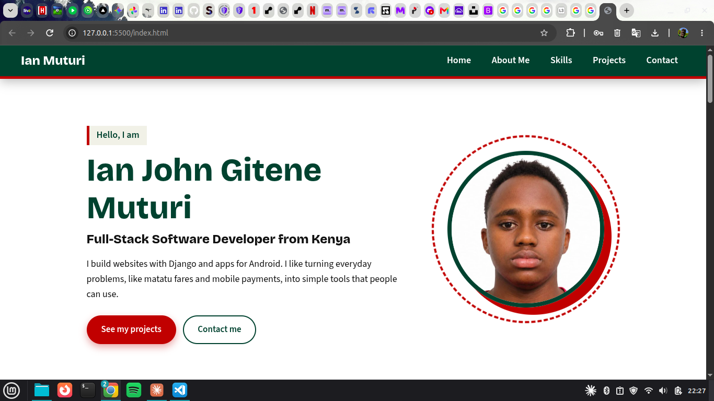
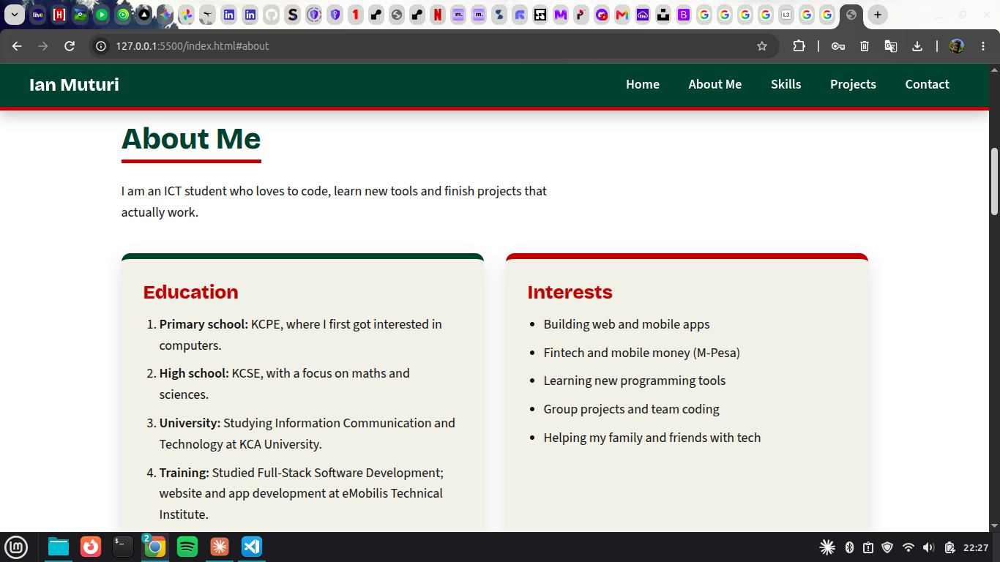
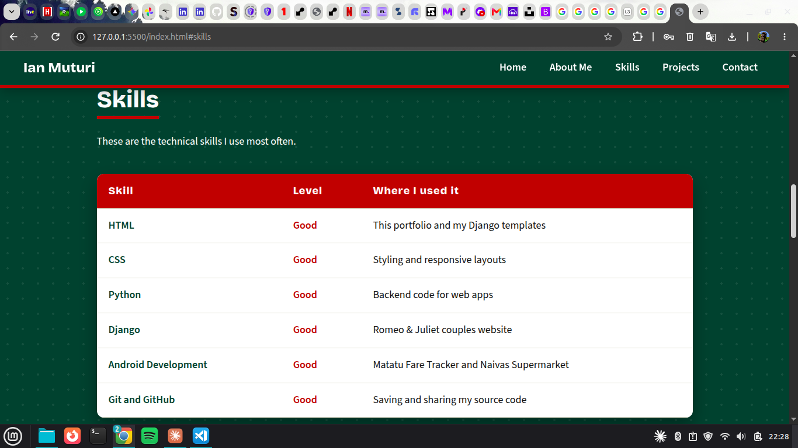
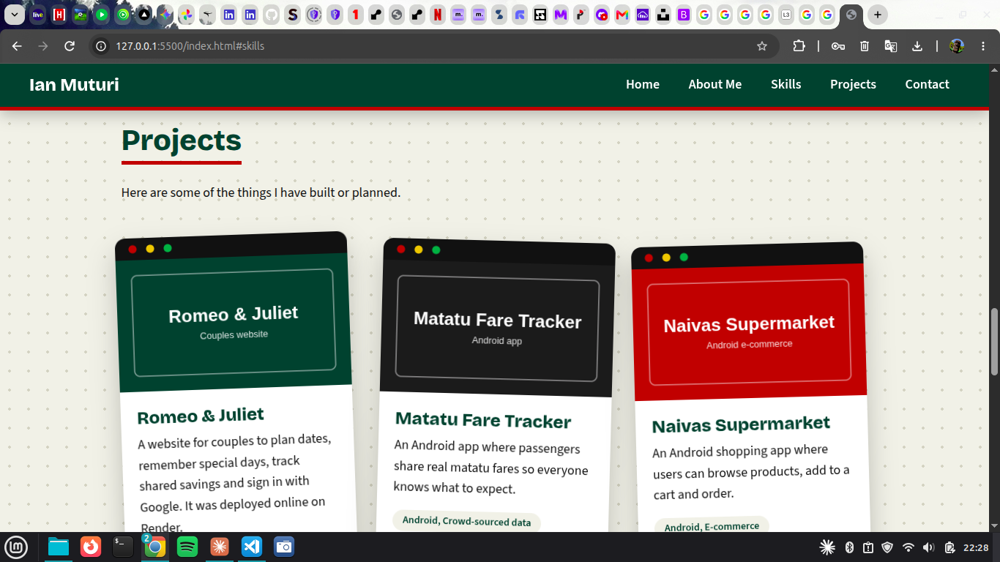
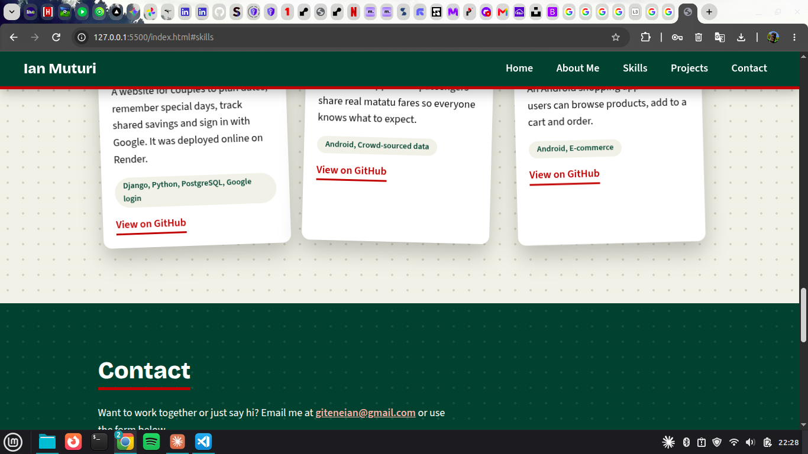
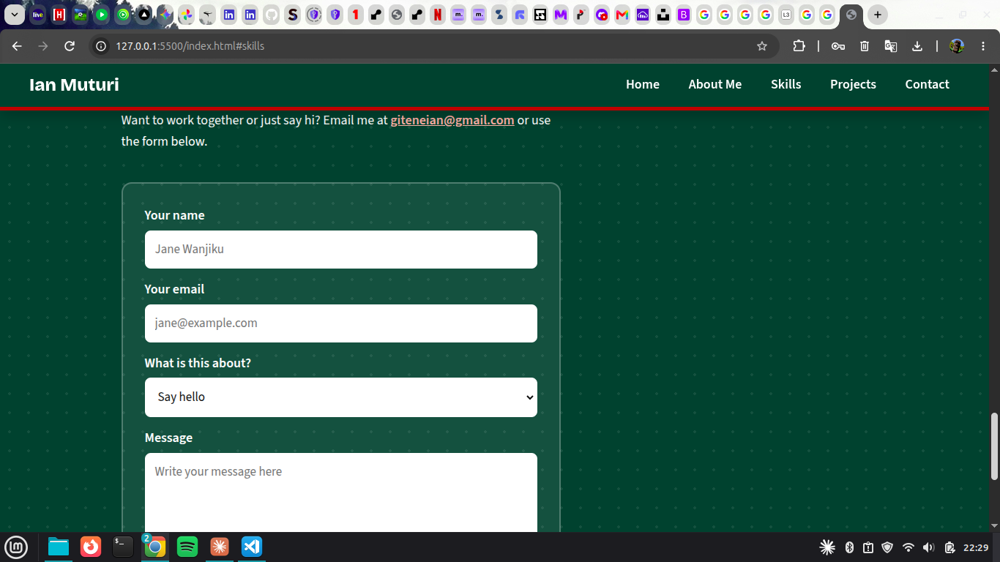
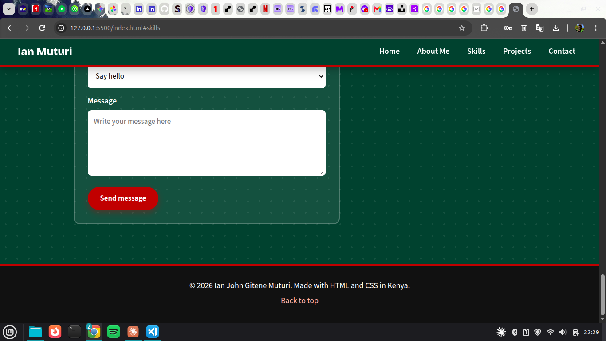
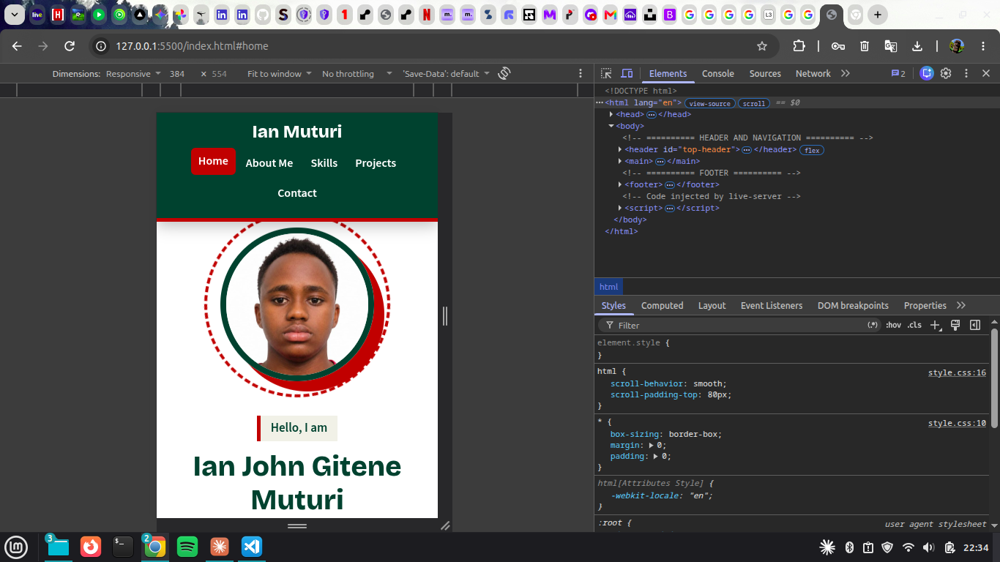
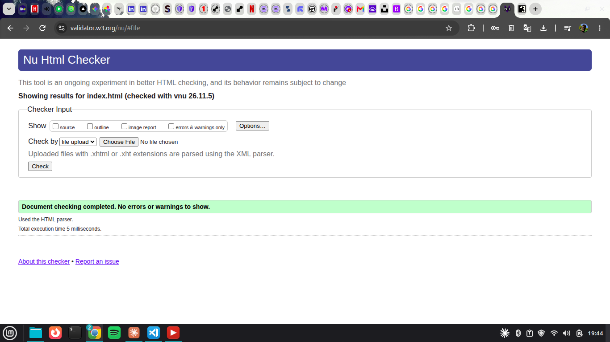
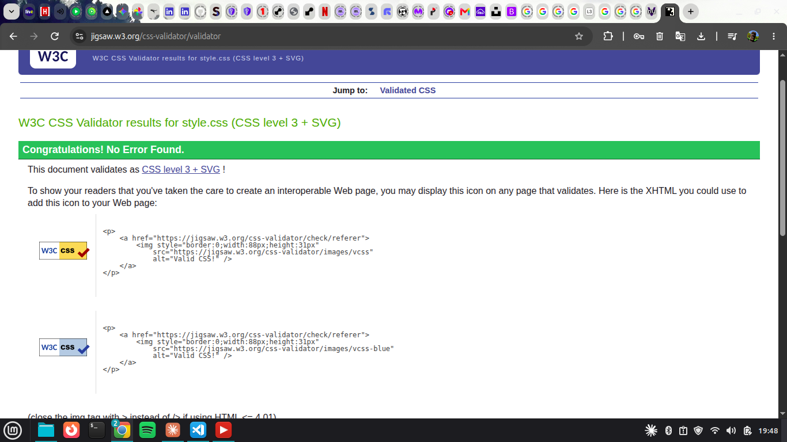

# Personal Portfolio

A simple personal portfolio website built with **HTML and CSS only**. It introduces me, lists my skills, shows my projects and gives my contact details.

**Live site:** https://YOUR-USERNAME.github.io/personal-portfolio/

## Pages (sections)

| Section  | What it contains |
|----------|------------------|
| Home     | Name, profile picture and short introduction |
| About Me | Education (ordered list) and interests (unordered list) |
| Skills   | Table with six technical skills |
| Projects | Three project cards: Romeo & Juliet, Matatu Fare Tracker, Naivas Supermarket |
| Contact  | Email address and a contact form |

## Folder structure

```
personal-portfolio/
├── index.html
├── style.css
├── README.md
└── images/
    ├── profile.jpg
    ├── romeo-and-juliet.svg
    ├── matatu-fare-tracker.svg
    └── naivas-supermarket.svg
```

## What I used

- Semantic HTML: `header`, `nav`, `main`, `section`, `article`, `footer`
- Headings, paragraphs, images, links, ordered and unordered lists, a table and a form
- External CSS with classes and IDs
- Margins, padding, borders and background colours
- Flexbox (header, home, about) and CSS Grid (projects)
- Hover effects on navigation links, buttons, table rows and project cards
- A media query so the site works on phones
- Colours from the Kenyan flag: green, red, black and white

## Testing

| Test | Result |
|------|--------|
| All navigation links jump to the right section | Pass |
| All images display correctly | Pass |
| Desktop screen (1366px wide) | Pass |
| Mobile screen (375px wide) | Pass |
| HTML checked with the W3C Markup Validator | Pass |
| CSS checked with the W3C CSS Validator | Pass |

Screenshots are in the `screenshots/` folder.

## How to run it

1. Download or clone the repository.
2. Open `index.html` in any web browser.

## Author

Ian John Gitene Muturi

## Screenshots

### Desktop








### Mobile


### Validation


